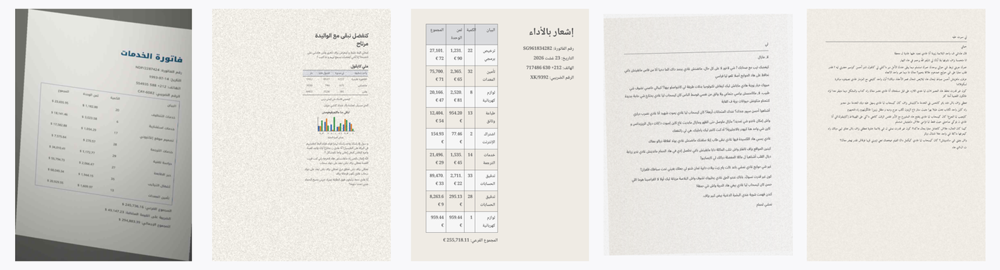
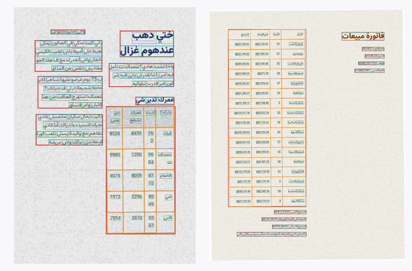
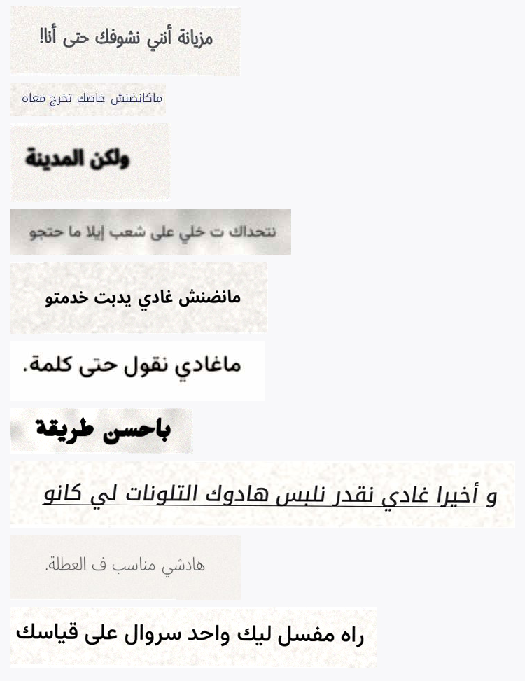
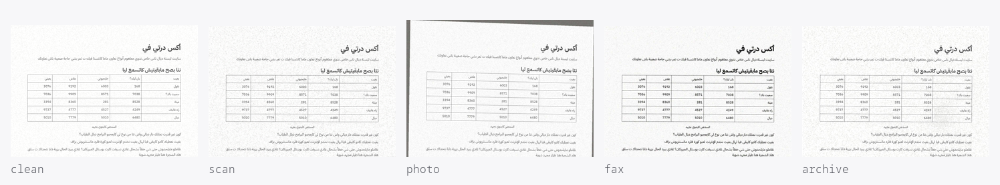
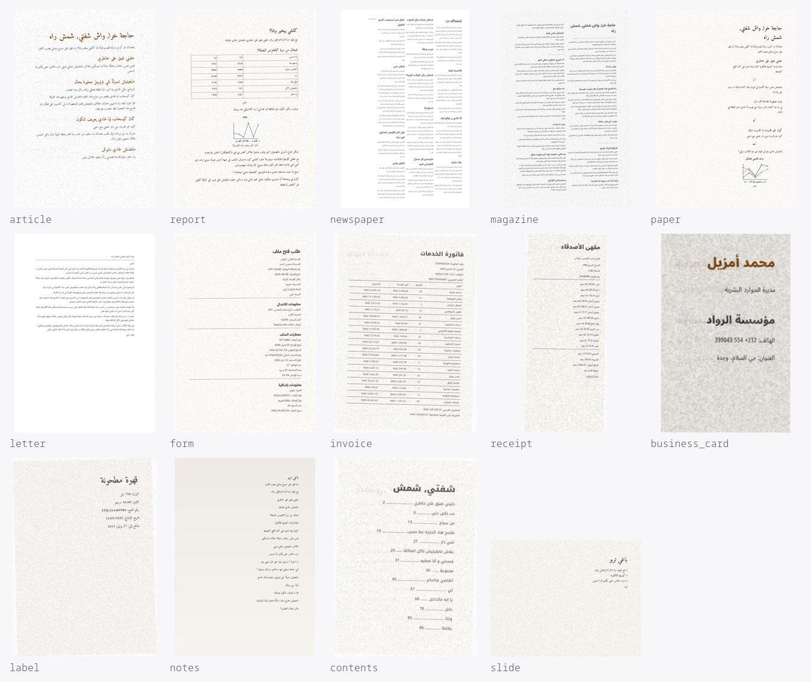
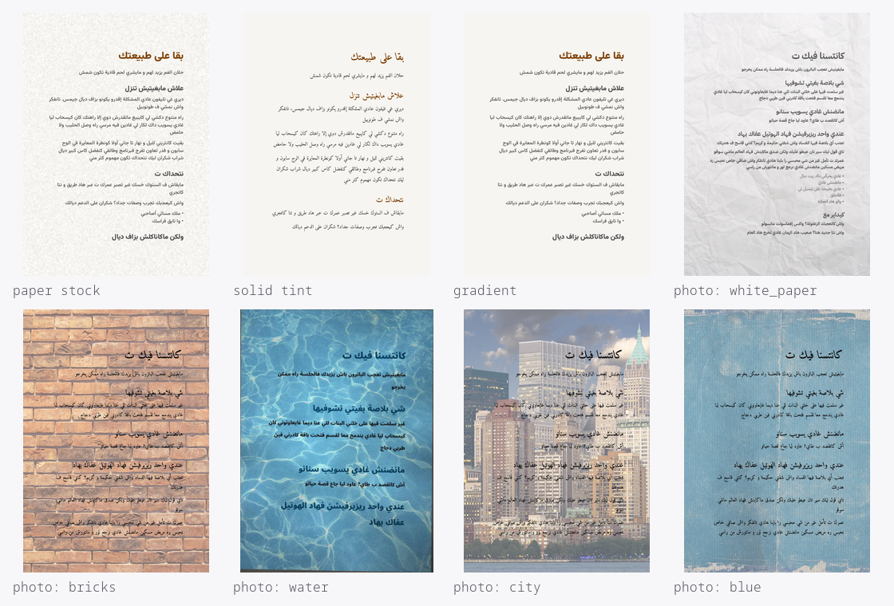
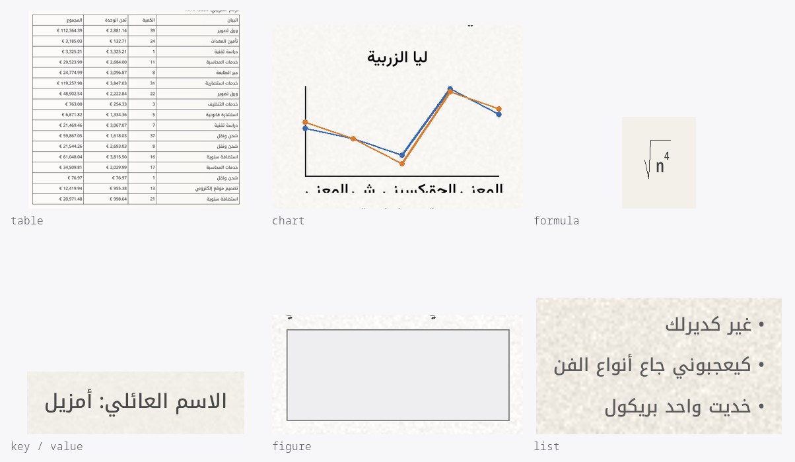
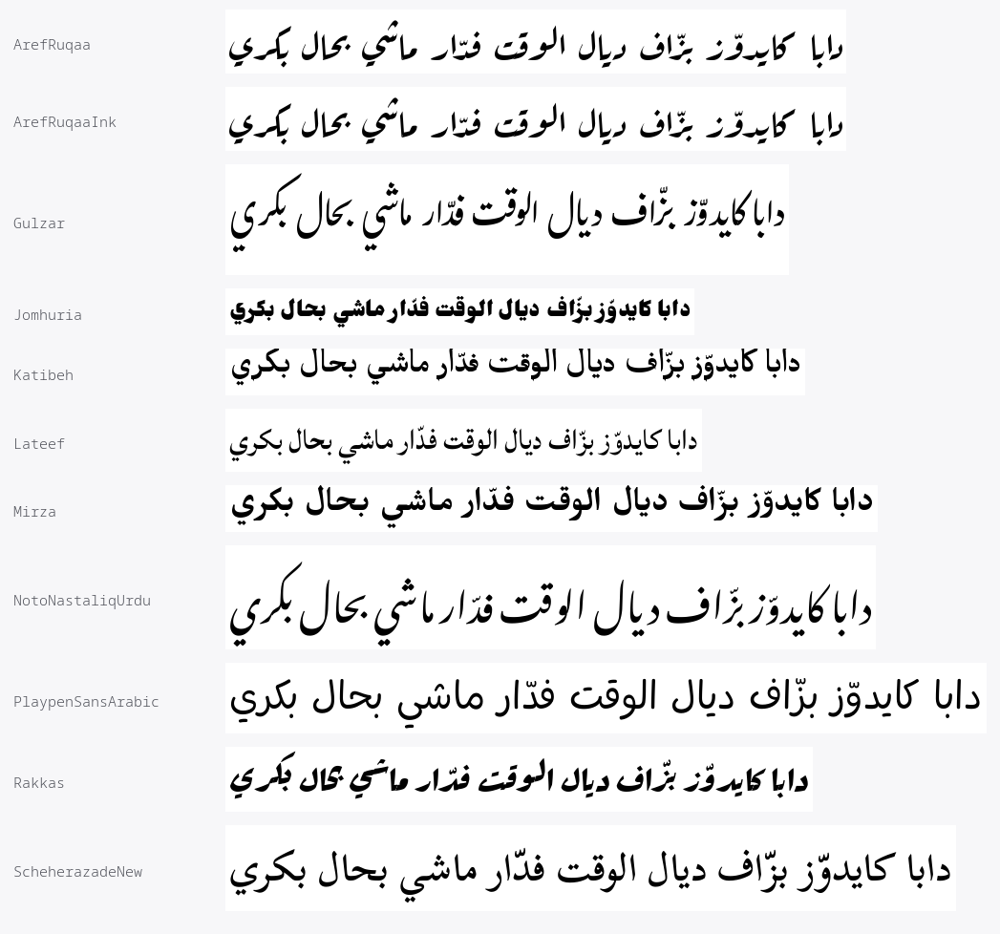

<h1 align="center">OCRSmith</h1>

<p align="center"><strong>Synthetic training data for OCR and document understanding, Arabic first.<br>
Whole pages, exact ground truth, and a line renderer when pages are more than you need.</strong></p>

<p align="center">
<a href="CHANGELOG.md"></a>
<a href="https://www.python.org"></a>
<a href="https://github.com/atlasia-ma/OCRSmith/actions/workflows/ci.yml"></a>
<a href="https://huggingface.co/blog/imomayiz/atlasocr"></a>
<a href="LICENSE"></a>
</p>

<p align="center"><code>pip install git+https://github.com/atlasia-ma/OCRSmith</code></p>



## About

Most synthetic OCR data is a line of text on a noisy background. That teaches a model to read a crop. It
does not teach it to read a page, and it has nothing to say about where the table was, which block was the
heading, or what order any of it should be read in.

OCRSmith renders whole documents — multi-column pages with titles, tables, charts, forms and running heads —
and emits the ground truth for every objective those pages can supervise, from the same pass that drew the
pixels. It also renders single recognition strips, about forty times faster per sample, for when a line is
genuinely all you need.

It is Arabic-first. Not "supports Arabic": the shaping, the glyph-coverage checks, the vertical metrics and
the diacritic policy are the parts that were designed first, because they are the parts that Latin-first
generators get silently wrong. OCRSmith produced 86% of the training corpus behind
[AtlasOCR](https://huggingface.co/blog/imomayiz/atlasocr), the first open-source Moroccan Darija OCR model,
which beats comparable models on [KITAB-Bench](https://arxiv.org/pdf/2502.14949).

The rule everything else follows from: **the annotation describes exactly what was drawn, no more and no
less.** A dataset that breaks it looks perfectly fine and teaches a model something false, and you find out
months later as a training plateau nobody can explain.

## A tour

<table>
<tr>
<td width="50%">
<br>
<b>Every box, at every level.</b> Regions in red, lines in blue, words in green, table cells in orange —
all produced by the same pass that drew the ink, so they cannot disagree with it. <i>Words are drawn
individually, which is what makes the word boxes exact and is safe in Arabic because letters never join
across a space.</i>
</td>
<td width="50%">
<br>
<b>Line strips, when pages are overkill.</b> <code>render.mode: line</code> draws recognition crops
directly — a thousandth of the pixels of an A4 page. <i>Same font pool, same paper, same degradations,
and the same per-word annotation as a page, so a strip is a one-line page rather than a different
kind of thing.</i>
</td>
</tr>
<tr>
<td colspan="2">
<br>
<b>Capture conditions, not noise.</b> One document, four named conditions. <i>Each is a physical chain —
the page meets the optics, the optics project and defocus it, the sensor samples it at its own resolution,
and only then is there noise and compression — so a corpus can be composed as "40% flatbed, 30% phone,
20% clean" rather than as an undifferentiated cloud of augmentation.</i>
</td>
</tr>
</table>

## Install

### With pip

OCRSmith is not on PyPI yet, so pip takes the repository directly:

```bash
pip install git+https://github.com/atlasia-ma/OCRSmith
```

Install the `shaping` extra too, unless you have a Pillow built with Raqm. It is what lets OCRSmith apply a
font's own `GSUB` and `GPOS` tables instead of substituting Arabic presentation forms, and the difference is
not cosmetic — see [Text engines](#text-engines):

```bash
pip install "ocrsmith[shaping] @ git+https://github.com/atlasia-ma/OCRSmith"
```

Tabular and Hugging Face corpora, and the Parquet and WebDataset export targets, need a few more packages:

```bash
pip install "ocrsmith[data,shaping] @ git+https://github.com/atlasia-ma/OCRSmith"
```

Then download some fonts. The repository ships none of its own — a dataset's licence has to be checkable,
so every family is fetched with its licence file and recorded in a manifest:

```bash
ocrsmith fetch-fonts --subset arabic --output assets/fonts
```

```bash
ocrsmith fetch-fonts --subset arabic --hands --output assets/fonts_hands
```

The second line fetches the families whose letterforms come from a written hand. It is deliberately wider
than Google Fonts' own `handwriting` category, which contains exactly one Arabic family — the styles people
actually write in, ruqʿah above all, are filed under Serif and Display.

### From the source

```powershell
# Windows (PowerShell)
git clone https://github.com/atlasia-ma/OCRSmith
cd OCRSmith
python -m venv .venv
.venv\Scripts\pip install -e ".[all]"
```

```bash
# macOS and Linux
git clone https://github.com/atlasia-ma/OCRSmith
cd OCRSmith
python -m venv .venv
.venv/bin/pip install -e ".[all]"
```

Check the machine before the first long run:

```bash
ocrsmith doctor
```

It reports the text engine, how many of your fonts can actually draw the script, and whether the corpus has
enough text in it to be worth rendering.

## Text engines

Pillow can only draw a string of characters. For Arabic that is not enough: the shape of a letter depends on
its neighbours, and the letter-to-shape mapping lives in the font's `GSUB` table, which Pillow applies only
when it was built with Raqm. Three ways out, and OCRSmith picks the best one available:

| Engine | Needs | Usable faces | Handwriting |
| --- | --- | --- | --- |
| HarfBuzz | `ocrsmith[shaping]` | 92 of 101 | yes |
| Raqm | a Pillow built with it | 92 of 101 | yes |
| Reshaper | nothing | 69 of 101 | **no** |

The reshaper rewrites the text into Unicode's Arabic presentation forms (U+FE70–FEFF), which are pre-joined
characters a plain renderer can draw one at a time. It is correct, and it is what this project shipped — but
that block is deprecated and modern faces do not implement it. They join through `GSUB` and carry no FExx
glyphs at all, so the coverage gate correctly refuses them. Aref Ruqaa, the standard ruqʿah hand, has 110
Arabic glyphs and zero presentation forms. Every handwriting and calligraphic Arabic face is in that
position, which is why the third row says no rather than fewer.

Raqm is harder to get than its documentation suggests: neither the conda Pillow nor the current PyPI
Windows wheel has it working out of the box, because the bundled libraqm looks for a `fribidi.dll` that is
not shipped. The `shaping` extra needs no system libraries, so it is the one to reach for.

## What it can build

Fourteen document genres, each on the stock its kind is actually printed on — a broadsheet for a newspaper,
an 80 mm roll for a receipt, a card for a business card:



Twelve paper sizes, one to five columns, portrait and landscape. Paper stock with fibre texture, solid
tints, gradients, and photographs of real surfaces — the ink follows the stock, so a page on dark slate is
set in a light colour rather than washed pale so that black text has somewhere to sit:



Tables, charts, formulas, key–value fields, figures and lists, each with the structured ground truth behind
it: the cell grid, the series values, the expression tree:



Handwriting, as far as a font can take it. Eleven hands — ruqʿah, nastaliq, naskh and informal — fetched
with `--hands`. Honest caveat: these are typefaces derived from writing, so a letter comes out identical
every time it appears, and a real hand does not. It covers the layout and the visual regime; it is not a
substitute for real handwriting data, and the `notes` template's docstring says so too:



## Quick start

```bash
ocrsmith preview --count 3 --boxes --output outputs/preview
```

Three pages and their annotation overlays, written somewhere you can look at them. When they look right:

```bash
ocrsmith generate --num-samples 50000 --workers 12 --output outputs/corpus --format jsonl
```

What each part means:

| Part | Meaning |
| --- | --- |
| `--num-samples` | Documents, not pages. A document may run to several pages. |
| `--workers` | Processes. Each generates *and writes* its own shard, so nothing funnels through the parent. |
| `--format` | `jsonl`, `parquet`, `webdataset`, `coco`, `paddleocr` or `chat`. |
| `--seed` | The base seed. Every sample derives its own from it and its index. |
| `--set` | Any config key, repeatable: `--set page.dpi_range=[150,300]`. |

A run is sharded, and a shard that finishes is left on disk complete, so re-running the same command skips
what is already there. "The job died at 80%" is a resume rather than a restart.

## From Python

The CLI is a thin wrapper. The same thing from code, where the whole public surface is a
config, a factory and a `Sample`:

```python
from ocrsmith import GenerationConfig, SampleFactory, load_config

config = load_config("examples/configs/darija_scan.yaml")   # or GenerationConfig(...)
factory = SampleFactory(config)                             # build once, reuse

for sample in factory.create(0):          # one document, one sample per page
    sample.image.save(f"{sample.id}.png")
    print(sample.page.text)               # the label, in logical order
    for region in sample.page.regions:    # typed blocks, in reading order
        for line in region.lines:
            for word in line.words:
                print(word.text, word.bbox.as_int())
```

`SampleFactory` is the document renderer. When the renderer should follow the config's
`render.mode`, import `build_factory` from the same place and call that instead — both
yield the same `Sample`, so nothing else in the loop changes:

```python
from ocrsmith import build_factory

factory = build_factory(config)   # SampleFactory, or the line renderer
```

To write a whole dataset rather than handle samples yourself, call `run_generation(config)`
— it shards, parallelises, validates and writes.

## What one page gives you

Everything below comes out of a single render, because it all describes the same pixels:

| Objective | What you get |
| --- | --- |
| Recognition | Line and word crops with logical-order text |
| Detection | Word, line and region boxes; polygons where the page is warped |
| Layout analysis | Typed regions (`title`, `table`, `figure`, `key_value`, …) in reading order |
| Document to markup | The page serialised back to Markdown and HTML |
| Table structure | The cell grid as HTML and as OTSL |
| Chart to JSON | The series values the chart was drawn from |
| Formula to LaTeX | The expression tree the formula was typeset from |

Labels are in logical order and the pixels are in visual order, which is the distinction a Latin-first
generator does not have to make and an Arabic one cannot avoid. See [docs/formats.md](docs/formats.md) for
what each export target writes.

## Two renderers

`render.mode` picks which one runs. Both expose the same thing downstream — a `Sample` with an image, a
`Page` and its provenance — so the writers, the quality gate and the CLI do not know which produced what
they are holding.

| | `document` | `line` |
| --- | --- | --- |
| One sample is | a page | a recognition strip |
| Annotation | regions, reading order, tables, lines, words | one line, with its words |
| Supervises | recognition, detection, layout, tables, charts, formulas | recognition |
| Cost | ~660 ms | ~16 ms |

The line renderer is not a cut-down copy of the document one. It shares the font pool, the paper, the
degradation presets and the text renderer, and it adds the thing a strip generator usually lacks: a sliver
of the line above or below, clipped into the margins and deliberately absent from the label, because that
is what a real crop out of a real detector contains. A corpus whose strips are always perfectly isolated
teaches a model that the top and bottom rows of pixels are always background.

It also does not feed on sentences. A recogniser is fed whatever a detector cut out, which is a much
stranger distribution: single words from form fields, a reference number with no sentence around it, three
unrelated words from a table row, a word sliced in half by a box edge. Those are sampled explicitly.

## Configuring a corpus

A corpus is defined by its distributions. Everything that varies per sample is a range or a weight map, and
pinning one narrows the dataset in a way that is invisible until a model fails on whatever was left out.

```yaml
text:
  source:
    type: csv
    path: corpora/darija.csv
    column: text
  diacritics:
    mode: mixed            # real Arabic is marked, lightly marked, or bare

page:
  papers: {a4: 4.0, a5: 1.0, letter: 1.0}
  dpi_range: [110, 200]
  columns: {1: 3.0, 2: 1.0}

degradations:
  presets: {clean: 1.0, scan: 4.0, photo: 3.0, fax: 0.5, archive: 1.0}

output:
  dir: outputs/corpus
  format: jsonl
  shard_size: 500
```

Start from [examples/configs](examples/configs) — `darija_scan.yaml` for a Hugging Face corpus,
`phone_photos.yaml` for camera captures, `tables_and_forms.yaml` for structure-heavy pages. Every key is
documented in [docs/configuration.md](docs/configuration.md), and `ocrsmith show-config` prints what your
file actually resolved to.

One setting is worth naming here, because leaving it alone is the commonest way to waste a run.
`text.source.type` defaults to `inline`, which means a handful of built-in sentences. Generating a hundred
thousand pages from it produces well-laid-out pages with exact labels, a quality gate that passes every one
of them, and a vocabulary of forty words. `generate` and `doctor` both say so before you start.

## Speed

Measured on one core of a 6-core machine with `ocrsmith bench`, which times the renderer with nothing
written to disk:

| Mode | Per sample | Per core |
| --- | --- | --- |
| `document` | 664 ms | 1.5 pages/s |
| `line` | 16 ms | 62 strips/s |

Both numbers are with the HarfBuzz engine, which costs about 30% against the reshaper and buys a third more
usable fonts, correct mark placement and handwriting at all. Documents are about 2.3x faster than they were
in 1.3.0, which came from four places and no micro-optimising.
Glyph coverage is computed once per face and cached on disk, so a hundred-face pool costs milliseconds per
worker instead of eight seconds. Skew and perspective compose into one homography and one resample instead
of two, which is also sharper, because the page is interpolated once. The smooth shading stages — shadow,
vignette, glare, stains, creases, uneven light — compose into a single multiply-and-add built at a fraction
of the page's resolution. And the capture chain is ordered the way a camera works, so the sensor's
downsampling happens before the noise and the compression rather than after them.

Scale with `--workers`, but check the shard count first. A shard is the unit of parallelism, so a run split
into two shards uses two processes however many you asked for:

```bash
ocrsmith generate -n 100000 -w 12 --set output.shard_size=8000
```

The rule is `shard_size ≈ num_samples / workers`. `generate` prints the advice when your numbers do not add
up, because the only symptom of getting it wrong is that the job finishes late.

## Reproducibility

Every sample derives its own seed from `(config.seed, index)`, so sample 8,412 can be regenerated on its own
months later without replaying the 8,411 before it. Nothing reads global random state.

Each sample carries its provenance: the font file and size, the background, the shaper, the template, the
capture preset and every degradation with the parameters it sampled. That is what makes it possible to ask
"which font and which condition produced this failure mode?" after training, rather than guessing.

The pipeline is a generator all the way down — a run of ten million pages holds one page in memory at a
time — and each worker writes its own shard rather than sending images back through a queue.

## Checking the corpus

Synthetic data fails quietly. Blank pages, washed-out text and boxes off the canvas do not raise; they just
teach a model something false. So a quality gate runs inside the pipeline, and a shard that rejects more
than `quality.max_rejection_rate` of its samples fails loudly instead of writing a dataset full of holes.

```bash
ocrsmith validate outputs/corpus      # re-check annotations against the images
ocrsmith stats outputs/corpus         # what the dataset actually contains
ocrsmith compare outputs/corpus real/ # how far it is from a real corpus, feature by feature
```

`ocrsmith ablate` builds the paired corpora that answer "does this feature actually help?", and
`ocrsmith evaluate` scores a model's predictions against a generated benchmark, with diacritics counted or
ignored as an explicit argument rather than a silent convention.

## Contributing

Issues and pull requests are welcome. [CONTRIBUTING.md](CONTRIBUTING.md) covers the setup and the house
style, [docs/architecture.md](docs/architecture.md) explains why the subsystems are split the way they are,
and [CHANGELOG.md](CHANGELOG.md) records what changed in each release. The test suite is the specification:
if a change could move pixels without moving the annotation, or claim text that was not drawn, that is the
test to write first.

```bash
pytest          # 711 tests
ruff check src tests
```

## License

[MIT](LICENSE). The fonts and corpora you fetch carry their own licences, and `ocrsmith fetch-fonts` records
them alongside what it downloads.
